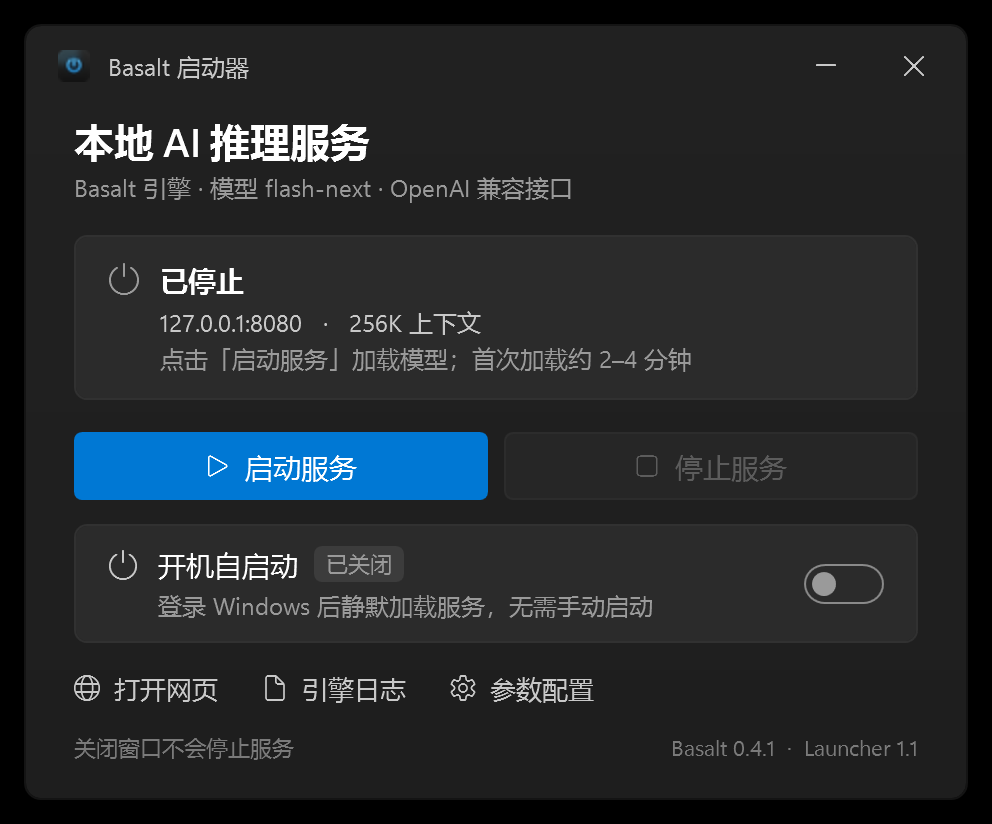

# Basalt 启动器 / Basalt Launcher

WinUI 3 / Fluent 风格的 [Basalt](https://github.com/yanmindi/basalt-arm-sm121) 本地推理服务启动器：启动 / 停止服务、开机自启动、状态卡（PID、运行时长、模型、端口、上下文），以及打开网页 / 引擎日志 / 参数配置。Windows 11，纯 Windows PowerShell 5.1 + WPF，单目录、无第三方依赖。

A WinUI 3 / Fluent-style control panel for a [Basalt](https://github.com/yanmindi/basalt-arm-sm121) local inference server on Windows: start / stop the service, toggle logon autostart, watch health, PID and uptime, and jump to the web UI, engine log or config file. Pure Windows PowerShell 5.1 + WPF — no Python, no Node, no packages.



## 功能

- **启动 / 停止服务**：调用 Basalt 自带的 `start.cmd silent` 与 `stop.cmd`；启动中途也能停下（会连同启动链一起结束）
- **状态卡**：每 1.2 秒轮询 `/health` + `logs\serve.pid`，显示 运行中 / 正在加载模型 / 正在启动 / 正在停止 / 启动失败 / 已停止，以及 PID、运行时长、模型名、端口、上下文
- **开机自启动**：写 / 删 `HKCU\Software\Microsoft\Windows\CurrentVersion\Run\BasaltLocalAI`，与 `bin\autostart.cmd` 是同一项；登录 Windows 后由 `bin\boot.vbs` 静默拉起服务
- **快捷入口**：打开网页（`http://127.0.0.1:8080`）、引擎日志、`bin\config.cmd`
- **不打断服务**：点 ✕ 不会停止服务，而是把启动器收进系统托盘（可以在托盘菜单里关掉这个行为）
- **系统托盘**：收起后右下角留一个图标，悬停显示服务状态；**单击** = 叫出右下角的监控面板并提到最前，**双击** = 叫回主窗口，右键菜单 = 显示主窗口 / 启动服务 / 停止服务 / 打开网页 / 显示·隐藏监控面板 / 关闭时收进托盘（勾选项）/ 退出。只有「退出」才会真的关掉启动器
- **单实例**：重复双击只会把窗口叫到前台——窗口收在托盘里时也一样，第二个实例会自己退出并让第一个把窗口显示出来
- **监控读数**：状态卡多一行 空闲/生成中、tok/s、GPU%、温度、显存（`GET /metrics`，约 3.6 秒一次）；同一份数据进托盘悬停文字，托盘图标按状态上色（空闲=系统强调色 / 生成=绿 / 加载=黄 / 告警=红 / 停止=灰）
- **收放监控面板**：界面和托盘菜单里的「监控面板」显示 / 隐藏 `tray\tray.py` 那块桌面面板——它现在以 `--no-tray` 跑，不再挂第二个托盘图标；**单击托盘图标**只"叫出并提到最前"（已显示也不会藏起来，因为面板默认不总在最前、容易被别的窗口盖住）；面板自己的右键菜单里有「Basalt 启动器窗口」反向叫回这里
- **系统通知身份**：托盘提示走 Windows 通知中心，抬头是「Basalt 启动器」+ 自己的图标（进程 AUMID + 启动时在 `HKCU\...\AppUserModelId` 注册 `DisplayName` / `IconUri`）
- **Fluent 细节**：系统强调色、Fluent 开关 / 按钮 / 深色 ToolTip、加载时旋转的状态图标、自绘 40 px 标题栏与窗口按钮

## 界面

Windows 11 深色 Fluent：`#202020` 近 Mica 底色、`#2B2B2B` 卡片、4/6/8 px 圆角、Segoe UI Variable 字体。主按钮使用**系统强调色**（读 `UISettings.AccentColor`，失败回退 `#0078D4`），所以系统换主题色时会自动跟着变。

## 环境

- Windows 10 1809+ / Windows 11（按 Windows 11 Fluent 设计；Win10 上自动退回 Segoe UI / Segoe MDL2）
- Windows PowerShell 5.1（系统自带，不需要 PowerShell 7）
- 一个 Basalt 部署，目录里至少有：
  - `start.cmd`（支持 `start.cmd silent`）
  - `stop.cmd`
  - `bin\config.cmd`（提供 `HOST` / `PORT` / `MODEL_NAME` / `MAX_CONTEXT` / `PIDFILE` / `LOG`）
  - 引擎的 `/health` 接口（就绪返回 200）
- 启动器本身不需要 Python / Node / 任何第三方包（「监控面板」只是负责显示 / 拉起 `tray\tray.py`，那个进程才需要 Python）

## 安装

1. 把整个仓库放进 Basalt 根目录，目录名用 `launcher`，例如：

   ```
   C:\Program Files\basalt\
     start.cmd
     stop.cmd
     bin\config.cmd
     launcher\            <- 本仓库
       launcher.ps1
       launch.vbs
       ...
   ```

2. 运行 `install-shortcuts.ps1`（当前用户即可，免管理员），会在桌面和开始菜单创建「Basalt 启动器」。
3. 双击快捷方式。

如果不想放在 Basalt 目录里，也可以显式指定根目录：

```powershell
powershell -NoProfile -STA -ExecutionPolicy Bypass -File .\launcher.ps1 -Root "D:\basalt"
```

`launcher.ps1` 默认把**上一级目录**当 Basalt 根目录，从中读 `bin\config.cmd`、调用 `start.cmd` / `stop.cmd`。

## 文件

| 文件 | 作用 |
|---|---|
| `launcher.ps1` | 主程序（UTF-8 带 BOM，需 Windows PowerShell 5.1 / STA） |
| `launch.vbs` | 隐藏控制台启动 powershell（快捷方式指向它） |
| `launcher.cmd` | 双击入口，无窗口 |
| `launcher-debug.cmd` | 带控制台启动，排错用 |
| `install-shortcuts.ps1` | 重建桌面 / 开始菜单快捷方式（当前用户，免管理员） |
| `launcher.ico` / `launcher.png` | 图标（256 px 多尺寸 ICO） |
| `screenshot.png` | 界面截图 |

## 配置

界面本身只有一个偏好：托盘菜单里的「关闭时收进托盘」，存在 `%LOCALAPPDATA%\BasaltLauncher\settings.json`（放这儿是因为 Basalt 常装在 `Program Files`，普通权限写不进去）。服务参数都在 Basalt 的 `bin\config.cmd` 里（`MAX_CONTEXT` / `PARALLEL` / `KV` / `RAM_RESERVE` / `EXTRA_FLAGS`）。改完在启动器里「停止服务」再「启动服务」即可。启动器运行日志在 `<basalt-root>\logs\launcher.log`。

## 排错

- 窗口没出来：先确认没收进托盘（点任务栏上的「显示隐藏的图标」箭头，找「Basalt 启动器」）；再运行 `launcher-debug.cmd` 看报错，或看 `logs\launcher.log`
- 想常驻在任务栏上：Win11 默认把新托盘图标收进「显示隐藏的图标」折叠区，把图标从折叠区拖到任务栏即可常驻（或 设置 → 个性化 → 任务栏 → 其他通知区域图标）
- 一直停在「正在加载模型」：先看 Basalt 的 `status.cmd`、`logs\serve.log`，再看引擎日志 `C:\Users\<用户名>\.cache\basalt\<hash>\engine.log`
- 启动失败代码：`1` = 引擎 / 模型包 / Python 缺失，`2` = 15 分钟仍未就绪，`3` = 引擎立即退出
- 更换模型：改 `bin\config.cmd` 的 `MODEL` / `MODEL_NAME` 后，在启动器里停止再启动
- 移动项目目录后：重新运行 `install-shortcuts.ps1`，并把「开机自启动」关一下再开（注册的是绝对路径）

## 已知边界

- 这是 **WPF 复刻 WinUI 3 视觉**，不是 Windows App SDK 应用：没有真实 Mica 模糊，用 `#202020 → #1E1E1E` 渐变近似；窗口按钮是自绘的
- 依赖系统字体 Segoe UI Variable / Segoe Fluent Icons（Win11 自带），缺失时自动退回 Segoe UI / Segoe MDL2 Assets
- 强调色读取失败时回退 `#0078D4`
- 只面向 Windows，且按 Basalt 的目录布局（`start.cmd` / `stop.cmd` / `bin\config.cmd` / `logs\serve.pid`）工作
- 检测「服务进程存活」时会校验 PID 对应进程名为 `basalt.exe`（防止 PID 复用误判）

## 协议

[GPL-3.0](LICENSE)

## English

Basalt Launcher is a single-folder Windows PowerShell 5.1 + WPF app that puts a WinUI 3 / Fluent-style face on a [Basalt](https://github.com/yanmindi/basalt-arm-sm121) local inference server. It starts and stops the server through the project's own `start.cmd silent` / `stop.cmd`, polls `/health` plus `logs\serve.pid` once a second, shows PID / uptime / model / endpoint / context, toggles logon autostart via `HKCU\...\Run\BasaltLocalAI`, and opens the web UI, engine log or config file. Closing the window never stops the server — by default it hides the launcher into the system tray, where a left-click or double-click brings the window back and the right-click menu offers Show window / Start service / Stop service / Open web UI / a "hide to tray on close" toggle / Quit (only Quit really exits). A named mutex keeps it single-instance, so launching it again while hidden just asks the running copy to show itself. It also polls `/metrics` so the status card and the tray tooltip show decode speed, GPU utilisation, temperature and VRAM, tints its tray icon with the current state (idle = system accent, generating = green, loading = amber, warning = red, stopped = grey), and shows or hides the desktop monitor panel drawn by `tray\tray.py` — that process runs with `--no-tray` now, so there is only ever one Basalt tray icon. Once the launcher is collapsed to the tray, a **single click** on that icon brings the monitor panel forward (raising it above whatever was covering it) and a **double click** restores the main window. Tray notifications carry their own identity: the launcher registers its `AppUserModelID` (`DisplayName` + `IconUri`) under `HKCU` on startup, so Windows labels them "Basalt Launcher" with the launcher's icon instead of "Windows PowerShell". The accent colour follows the Windows system accent, and the UI degrades gracefully on Windows 10. Copy the folder into your Basalt root as `launcher\`, run `install-shortcuts.ps1`, then launch it from the desktop. GPL-3.0.

---

与 [basalt-tray-monitor](https://github.com/Yimuer/basalt-tray-monitor) 同一套代码风格；都只碰 Basalt 的 HTTP 接口和启动脚本，不改引擎一行代码。
